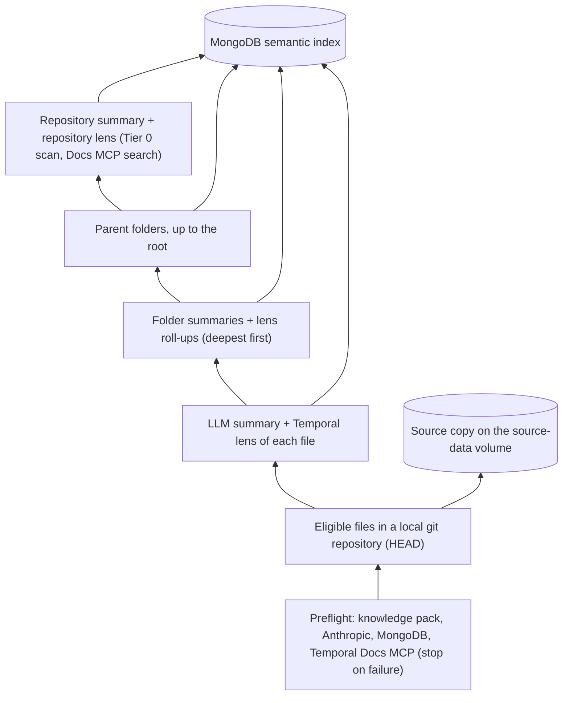
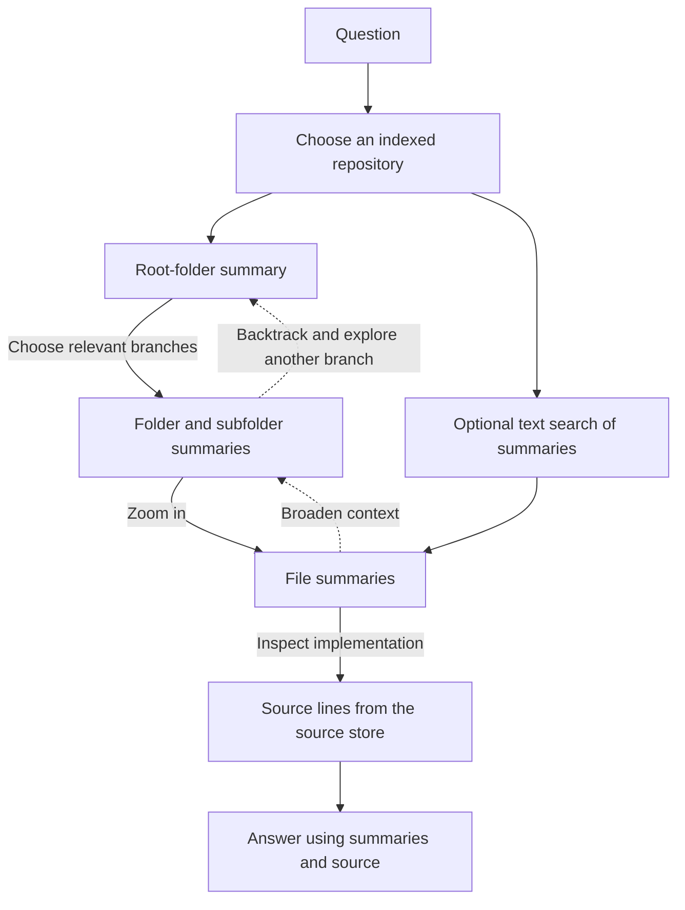

# Indexing and question flow

## Indexing builds summaries upward

`semantic_ingress` walks the committed git tree and filters files for eligibility (binary files, oversized files and excluded patterns are skipped). Each eligible file is analysed by the index model. For each folder, the indexer combines that folder's direct file summaries with the summaries of its child folders, starting at the deepest folders and working toward the root (`.`). Because each child folder summary already covers its own subtree, every folder summary describes everything beneath it, and it carries exact subtree counts (files, folders, depth). On incremental runs a file is re-summarised whenever its git blob changed; every surviving ancestor folder of a changed or deleted file is then rebuilt from all of its children, reusing the stored summaries of unchanged ones.

Summaries are written to MongoDB (one database per repository, `<DB_PREFIX>_<name>`). Source files are copied to `<SOURCE_DIR>/<name>/<path>` so the query agent can retrieve implementation details later, and the git blob ID of every copied file is recorded so later runs know what changed. A directory listing is stored for direct path lookup.

Finally, one more LLM call writes a repository-level summary (purpose, major areas, notes) from the root-folder summary and the top-level folder summaries. It is stored as the `repo_summary` document and is what `get_repo_summary` and the repository list show. In incremental runs it is regenerated only when a folder summary changed, or when the index has none yet.

Source: `semantic_ingress/semantic_ingress/core/generation_orchestrator.py`, `artifact_generator.py`, `git_adapter.py`, `source_mirror_orchestrator.py`, `storage/mongo_store.py`.

## The Temporal lens

With `LENS_ENABLED=true` (the default), every run starts with a preflight (`semantic-ingress preflight`; `scripts/index.sh` runs it first) that checks the knowledge pack, the Anthropic API, MongoDB, and the Temporal Docs MCP (a token refresh and a canary search). Any failure stops the run before anything is spent.

Each file's summary call also returns a **lens record**: durable-execution relevance (0-3), the file's role, signals from a closed vocabulary (side effects, waits, hand-rolled retries, status tables, Temporal SDK use, ...), Temporal knowledge-pack concept ids, review-check leads for existing Temporal code, and a short narrative. The pack (`knowledge/temporal-pack.yaml`, checked against the Temporal docs) is sent as a cached system prompt: a conversion view for ordinary code, an evaluation view (with the file language's SDK checks) for code that uses a Temporal SDK. Records are normalised in code (unknown ids dropped, caps enforced).

Folders get a **roll-up** of every lens record beneath them (exact counts, merged up the tree) and, where something relevant lives below, a short lens narrative written in the folder call. The repository gets a **repository lens**: a deterministic Tier 0 scan of manifests and imports (Temporal SDKs, Airflow, Celery, ...), then one LLM pass over the roll-up and the most relevant file records that must search the Temporal Docs MCP for the pattern behind each key process. Its answer is checked in code: detected technologies come from Tier 0 only, the Temporal status must agree with the file count, paths must be indexed files, and citations must be pack ids or docs URLs the search returned in that run.

Every lens record carries the pack version that produced it, and `index_meta` records the pack and per-version file counts (shown in the UI). A newer pack does not regenerate anything by itself: changed files use it, and `--refresh-lens` regenerates every file's lens (without re-summarising) and all roll-ups.

Source: `semantic_ingress/semantic_ingress/lens/` (`pack.py`, `normalize.py`, `rollup.py`, `tier0.py`, `repo_pass.py`, `mcp_docs.py`), `preflight.py`.

## The Temporal report

`scripts/report.sh <name>` (`semantic-ingress report`) runs the same preflight and loads the report rubric, then builds the report from the index and the mirrored source:

1. **Verify leads.** Each gate the repository lens raised, and each review-check finding in a Temporal file's lens, is checked against the mirrored source, one call per file. Only confirmed leads are used.
2. **Find processes.** The repository lens's processes, plus relevance-2 entry points no process covers; at most 8. In a partly Temporal repository, processes that touch Temporal code are reviewed instead (step 5).
3. **Investigate each process.** One tool-using call per process reads the index (summaries, lens records, text search) and the source (line reads, regex search across files) and fills in a process card. The card holds facts with line references: trigger, unit of work and scale, steps and side effects, state, persistence, crash loss, reliability code, waits and run length. Code drops references to lines the investigator never saw. A second call checks each fact against its cited lines and drops what they do not support. Cards are stored in `process_cards` with the blob ids they depend on, and reused while those are unchanged.
4. **Score and write up each process.** The rubric's value paths and modifiers are scored from the card in one structured call, with fact ids as evidence. Code computes fit (the strongest value path) and the overall score, capped by gates verified for the process. A docs-search call then writes the design (from 5/10) or the reasons it is not a fit. Code checks process names, paths and citations, retries once, and drops what still fails.
5. **Evaluate existing Temporal code.** Bars computed in code from confirmed findings by severity; a fix per finding.
6. **Render** a fixed Markdown template, plus the same data as JSON, to `reports/<name>/`.

With the lens on, `sync` runs these steps after the index is saved and the source mirrored, and stores the report in the `reports` collection (a failure keeps the last good report and never fails the index). Each model step is cached in `report_cache`, keyed on its inputs: lead verdicts on the file's blob, each process's scores and write-up on its card, the verified gates and the rubric, pack, model and prompt versions. Incremental runs keep the process list stable: the repository lens pass sees the previous processes and the changed files.

In chat, `get_temporal_report` reads the stored report (overview, one process, or the evaluation) and `search_temporal_docs` searches the Temporal docs; the system prompt states whether a report exists and its headline verdicts. The UI's report view reads `/api/report/<name>`, and its detailed report reads `/api/report/<name>/markdown` (the stored Markdown).

Source: `semantic_ingress/semantic_ingress/report/`.

## Questions move down and can revisit broader context

The browser posts the conversation to `/api/chat`. The agent (Strands with the Anthropic provider) selects tools to list repositories, retrieve summaries, search summary text, and fetch source. The server streams the answer back as server-sent events. For questions about durability, failure handling, orchestration or Temporal, the summary tools are called with `include_lens=True`, which appends the lens record (or roll-up, or repository lens); otherwise the lens is left out so ordinary questions cost no extra tokens. Text search covers summary and lens text.

For a broad question, the agent starts at the root and follows relevant folders. For a named file, `get_dir_listing` provides a shortcut. `text_search_summaries` searches file and folder summaries within one repository. The LLM decides which context to retrieve and can answer from summaries alone when source is unnecessary.

Source: `code_atlas/agent.py`, `config.py` (system prompt), `tools/`.
